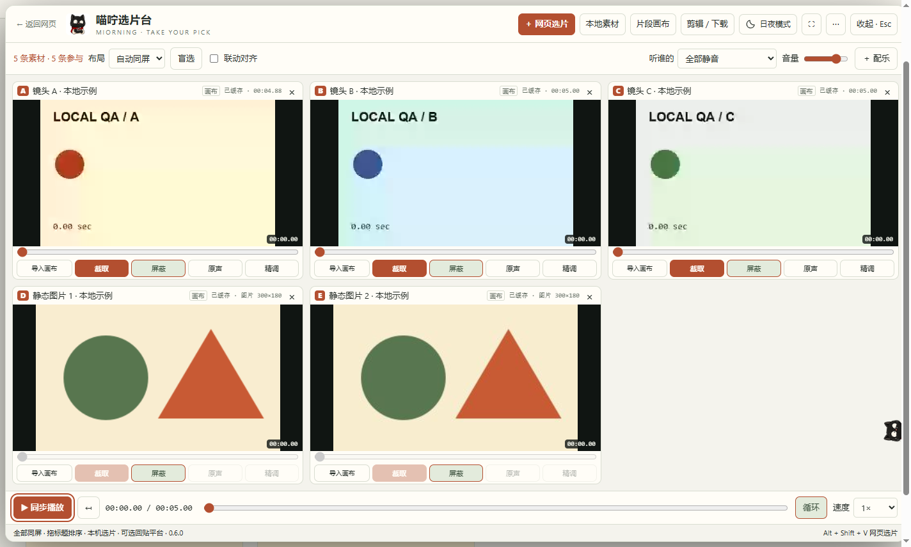

# Miorning Select · 喵咛选片台

Compare images and videos together. Pick a clip and bring it back to your canvas.

**v0.6.0 · Desktop Chrome / Edge extension · Manifest V3 · GPL-3.0-only**

[Download](https://github.com/miorning/miorning-select/releases/latest) · [简体中文](README.md) · [Release notes](RELEASE-NOTES.md) · [Six video covers](docs/COVERS.md) · [Privacy](docs/PRIVACY.md) · [MIORNING on Bilibili](https://space.bilibili.com/353186187)

*The cover is a promotional illustration. See the actual extension screenshot below. The extension interface is currently in Chinese; documentation is available in Chinese and English.*

## Keep your candidates in one view

When you have many video candidates, switching between windows makes comparison harder. Miorning Select puts media from a webpage or your computer into one panel so you can compare, reorder and select the useful parts.

- **Compare images and videos together:** select media on a webpage, choose local files or drag them in. Up to 16 items share one view, with ordering, blind comparison, exclusion and deletion.
- **Images stay still:** playback does not move images or their timelines. Animated images such as GIFs are shown as a single frame captured when loaded. Original files remain intact; images are excluded from the video editor.
- **Pick a two-second clip:** choose a start frame and duration, defaulting to 2 seconds. You can also take the final 2 seconds or select backward from an endpoint. Confirmation immediately adds a card to the extension's clip canvas, which supports up to 64 clips in one view.
- **Bring media to the current page:** original images, videos and supported exported clips can be handed to an add/upload/attachment input. Each import uses a distinct filename. Existing nodes are not replaced, and chat messages are not sent automatically.
- **Continue across pages:** media, music, clips and ordering are stored in the current browser profile's extension library and restored across page changes and browser restarts. Delete individual items or clear the library when finished.
- **Choose where the music starts:** set source in/out points and a timeline delay, with auditioning. Full-sequence preview follows the selected imported music or original clip audio.
- **A small cat at the page edge:** the cat head appears on ordinary pages by default, expands on hover and retracts afterward. Installation does not open a welcome tab. Light/dark mode is free; 17 application shortcuts are configurable from the top-right menu.

## Actual interface

This screenshot uses local demo media and the actual extension, with no private accounts or user cache. Original media and clips have separate layouts that fit up to 16 and 64 items respectively without horizontal or vertical scrolling. Smooth simultaneous playback of high-resolution media still depends on your hardware.

## Install in Chrome / Edge

1. Open [Releases](https://github.com/miorning/miorning-select/releases/latest) and download **`MiorningSelect-v0.6.0.zip`** under **Assets**. GitHub's automatic `Source code (zip)` is a repository snapshot; the named package is the prepared download.
2. Extract it to a directory you intend to keep.
3. Open `chrome://extensions` in Chrome or `edge://extensions` in Edge and enable **Developer mode**.
4. Choose **Load unpacked** and select the **`extension` folder** inside the package. That folder must directly contain `manifest.json`.
5. Refresh existing ordinary webpages and click the cat head at the page edge.

No build step, dependency installation, extension account or persistent local server is required. Do not delete or move the loaded directory. This project is distributed through GitHub and **is not listed in a browser extension store**.

This release was tested as a real Manifest V3 extension in Chrome. Edge's unpacked installation procedure is provided, but a complete independent Edge validation is not claimed for this release.

## First use

1. Press **`Alt + Shift + V`** by default to enter page selection, click an image or video to add it, and press **`Esc`** to finish. The cat menu provides the same entry point.
2. Press **`Alt + Shift + M`** by default to open or close the workbench. Use **本地素材** (Local media) or drag files into it to add local images and videos.
3. Drag card titles to reorder and press play to compare. Images remain still. Their trim, original-audio and fine-edit buttons remain in place but are disabled.
4. Choose **截取** (Trim) on a video card, select a range and confirm. A clip appears immediately in the extension canvas and can also be handed back to the current platform.
5. The top-right **⋯** menu contains shortcut settings, local media/cache management and help. Application shortcuts and browser-level extension commands are configured separately.

## Update without losing your library

**Do not uninstall the old extension first.** Back up its program directory, replace the contents with the new package's `extension` files, reload the original extension in the browser's extension manager, then refresh your webpages.

The library is isolated by browser profile and extension ID. Loading a new directory, changing browsers or changing profiles may create a different identity; existing cache does not automatically follow it. A backup of the program directory **does not back up the media cache**. Uninstalling or clearing extension data deletes that cache, so retain your important original files separately.

The new library migrates the current or most recent legacy project. Other legacy records can be appended through cache management. If they exceed 16 image/video items, 1 music track or 64 clips, the extension reports the limit and retains the legacy records.

## Where media is stored

Files and editing state are stored in **IndexedDB for the current extension ID in the current browser profile**, using the database `miorning-select-persistence-v1`. This is a browser-managed local database, not a regular image or MP4 downloads folder. There is no automatic cross-device synchronization.

Local imports cache the original file. Selected online media is cached when readable, with a **250 MiB per-file limit**. Sources that require additional authorization, use DRM, cannot be read or exceed the limit are marked **仅链接 · 未缓存** (Link only · Not cached). The extension does not reduce quality to make caching succeed. If an uncached URL expires, select it again or import the original file.

Cache management shows file counts, media byte totals and incomplete cache status. Deleting an item releases its file and associated clips. Confirming **清空全部素材与缓存** (Clear all media and cache) removes the shared library, music, clips and legacy records while keeping theme and shortcut settings. A normal extension cannot open arbitrary system directories; a browser profile-path entry point is provided instead.

## Quality and compatibility boundaries

| Operation | Behavior and limits |
| --- | --- |
| Import a complete image or video | Hands over the original file bytes without recompression. The destination must expose a recognizable add/upload input and accept the format. |
| Quick single-clip export | Original-codec export currently supports **H.264 / AVC MP4**. It copies compressed source packets and preserves resolution and frame rate. Boundaries are rounded to source frames and may differ by one frame. Unsupported codecs and complex edit lists fail explicitly. |
| Multi-clip editing/download and audio mixing | **Re-encodes the result.** The single-clip packet-copy guarantee does not apply. |
| Image comparison | PNG, JPEG, WebP, GIF, AVIF, BMP and SVG depend on browser decoding support. Images are decoded at source dimensions and displayed proportionally; animated previews stay still, while imports retain the original file. |
| Reading webpage sources | Only files actually supplied by the webpage are available. A low-resolution proxy cannot recover an unavailable high-resolution original. Restricted pages, cross-origin iframes, DRM and special players may not be readable. |

The cat cannot appear on restricted browser settings pages or extension-store pages. Website layout changes can affect selection and importing.

**“Handed to platform” does not mean uploaded, saved or successfully added as a node.** Multiple candidate inputs require a user choice. If no suitable input is present, open the platform's add/upload interface and try again. The extension distinguishes handing over a file from detecting new media; check the final result on the destination platform. Logged-in production workflows for LibTV, Dreamina, GPT and other platforms have not each been validated. Passing local canvas/chat fixtures does not mean universal compatibility. Any transcoding after handoff is controlled by the destination platform.

## Permissions, privacy and verification

The extension requests `activeTab`, `scripting`, `storage`, `unlimitedStorage` and HTTP/HTTPS site access for its default cat, user-driven selection, source-file reads and local media library. Only user-selected media is cached. There is no project-operated upload service or telemetry endpoint. Choosing to import into a canvas hands the selected file to that webpage. See [Privacy](docs/PRIVACY.md).

v0.6.0 was tested in an isolated Chrome profile for image comparison, webpage selection, original-file caching and handoff, with regressions for the video library, music preview, shortcuts and add-only platform flows. Cached/imported images were checked by SHA-256. The 16-item mixed layout was checked at 1440×900 and 1000×720. Local-fixture results are not a claim that every website or device has been tested.

## Source and license

[`extension/`](extension/) contains the complete, directly loadable extension source. First-party code is licensed under **GNU GPL version 3 only (GPL-3.0-only)**. See [LICENSE](LICENSE).

GPLv3 **permits commercial use and paid distribution**. When distributing a covered version, provide its corresponding source to recipients, preserve notices and grant the rights required by the license. Private modifications used only by you do not require publication. Using this extension does not by itself require publishing all your own code, and the project adds no noncommercial restriction.

The bundled Mediabunny 1.62.0 retains its MPL-2.0 license. See [THIRD_PARTY_NOTICES.md](THIRD_PARTY_NOTICES.md) for third-party and artwork notices. Created by MIORNING; not affiliated with the supported browsers or media platforms.
